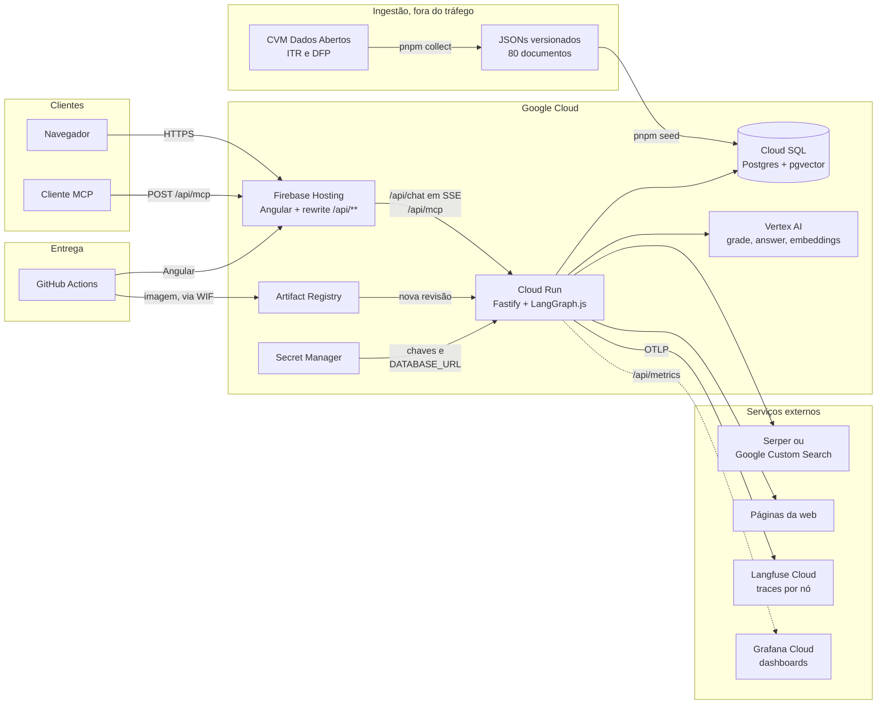
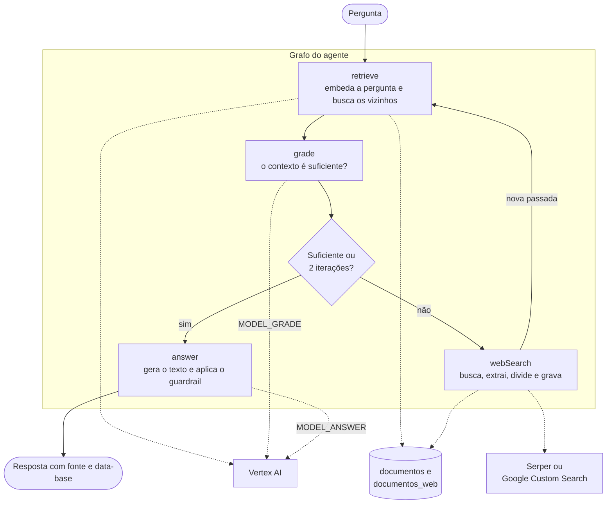
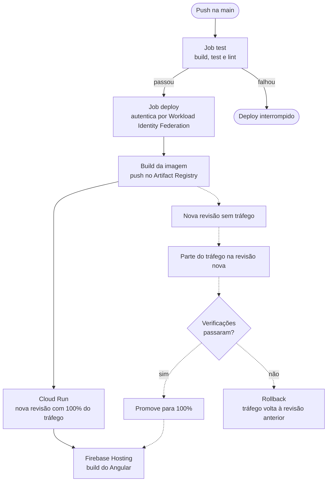

# AI Researcher

> **Este sistema informa, nunca recomenda.** Ele apresenta informações públicas e não oferece recomendação de investimento. A consultoria de valores mobiliários é atividade regulada pela CVM: nenhuma resposta sugere compra, venda ou manutenção de posição.

Chatbot que responde perguntas sobre indicadores financeiros de 20 empresas da B3, com citação da fonte e data-base do dado. É o projeto demonstrativo do módulo Capstone da Pós-Graduação em Engenharia AI-Native da UNIPDS: o código é material didático, escrito para ser lido linha a linha.

## Visão geral

A cada pergunta, o agente:

1. Busca na base vetorial os trechos mais próximos da pergunta.
2. Avalia se esse contexto basta para responder.
3. Quando não basta, busca na web, guarda o que encontrou e tenta de novo, no máximo duas vezes.
4. Responde citando a fonte e o período. Um filtro determinístico remove qualquer linguagem de recomendação que escape do prompt.

O corpus vem só dos formulários ITR e DFP da [CVM Dados Abertos](https://dados.cvm.gov.br/): 20 empresas, 4 trimestres, 80 documentos com receita líquida, lucro bruto, lucro líquido, ativo total, patrimônio líquido e caixa operacional. Ele contém apenas números, então perguntas qualitativas caem na busca web. Isso é intencional.

| Camada | Tecnologia |
| --------------- | ----------------------------------------------- |
| Monorepo | pnpm workspaces + Turborepo |
| API | Fastify + TypeScript |
| Orquestração | LangGraph.js |
| Frontend | Angular 22 (standalone, signals) |
| Banco | Postgres + pgvector (Cloud SQL) |
| LLM e embeddings | Vertex AI via LangChain.js |
| Busca web | Serper ou Google Custom Search, atrás de interface |
| Tools | MCP (stdio + Streamable HTTP) |
| Testes | Vitest + Playwright |
| Observabilidade | Langfuse + métricas no formato Prometheus |
| Deploy | Cloud Run + Firebase Hosting, via GitHub Actions |

## Arquitetura de infraestrutura

Linhas tracejadas marcam o que está previsto no plano, mas ainda não existe no repositório.



## O agente: RAG corretivo

O grafo é um Corrective RAG explícito. Cada nó é uma função de estado, e a decisão de rota vive só na aresta condicional depois do `grade`. Estourar o limite de iterações não é erro: o agente responde e avisa que o contexto é parcial.



## Pipeline de deploy canary

**O canary ainda não está implementado.** Hoje, `.github/workflows/deploy.yml` faz o caminho em linha contínua: cada push na `main` que passa nos testes vai direto para 100% do tráfego. As linhas tracejadas são o que a tarefa G.6 do plano acrescenta.



## Como rodar

Pré-requisitos: Node 24, pnpm e Docker. Sem credencial nenhuma, o modo demonstração troca o grafo inteiro por fixtures e devolve sempre a mesma resposta.

```bash
pnpm install
cp .env.example .env
docker compose up -d postgres
pnpm db:migrate
pnpm seed
pnpm dev
```

O `pnpm seed` chama a Vertex AI: ele exige `GOOGLE_CLOUD_PROJECT_ID` e credencial do Google Cloud. Para rodar sem isso, pule esse passo e use `DEMO=true` no `.env`. Em modo demonstração o chat não toca no banco; sem o Postgres de pé, só o `/api/health` responde `degraded`.

| Comando | O que faz |
| --------------------- | ---------------------------------------------------- |
| `pnpm dev` | API e web em modo watch |
| `pnpm build` | Build de todos os pacotes |
| `pnpm test` | Testes unitários |
| `pnpm test:e2e` | Caminho feliz do chat no navegador, com Playwright |
| `pnpm lint` | ESLint e Prettier |
| `pnpm collect` | Coleta da CVM, usada só na preparação do material |
| `pnpm db:migrate` | Aplica as migrações pendentes |
| `pnpm seed` | Popula o pgvector a partir dos JSONs versionados |
| `pnpm capstone:check` | Verificações de produção |

## Em produção

A instância deste repositório está em <https://ai-researcher-capstone-fn.web.app>.

- **Observabilidade:** cada pergunta vira um trace no Langfuse, com custo e latência por nó, quando as chaves `LANGFUSE_*` existem. `GET /api/metrics` expõe `llm_tokens_total` e `llm_cost_usd_total` no formato Prometheus, a partir dos tokens informados pela Vertex AI.
- **Rate limit:** `RATE_LIMIT_MAX` requisições por `RATE_LIMIT_WINDOW` milissegundos, por IP. `/api/health` e `/api/metrics` ficam de fora. `TRUST_PROXY_HOPS` diz quantos proxies há até a API: são 2 em produção, pelo Firebase Hosting.
- **Orçamento diário:** `DAILY_TOKEN_BUDGET` tokens por dia UTC. Esgotado, o `/api/chat` responde 429 em `application/problem+json`.

### Limitações conhecidas

- O canary e o rollback ainda não existem no workflow, e os dashboards do Grafana Cloud também não.
- `pnpm capstone:check` cobre 3 dos 12 itens do checklist, e `evals/` tem o dataset, mas não o runner.
- `/api/metrics` não tem autenticação: os totais de tokens e custo são públicos.
- Rate limit e orçamento ficam em memória, por instância. Com várias instâncias o limite real se multiplica, e reiniciar zera a conta. O orçamento também não bloqueia o `/api/mcp`, embora conte o que ele gasta. Isso não substitui um alerta de orçamento na conta do Google Cloud.
- Pela URL direta do Cloud Run há um proxy a menos, então o `X-Forwarded-For` pode ser forjado para burlar o rate limit.
- A tabela de preços é mantida à mão em `packages/agent/src/metrics/precos.ts`. O preço promocional do `gemini-3.6-flash` termina em 31/12/2026.

## Estrutura

```
apps/
  api/            Fastify, rotas, bootstrap
  web/            Angular
packages/
  agent/          grafo, nós, prompts, providers, métricas
  mcp-server/     registro das tools
  contracts/      schemas zod compartilhados
  corpus/         coleta CVM, normalização, geração de parágrafos
infra/            Dockerfiles e roteiro do Google Cloud
evals/            dataset de perguntas
scripts/          capstone:check
docs/             plano do projeto e quebra em tarefas
```

`apps/*` pode importar `packages/*`; `packages/*` nunca importa `apps/*`. As variáveis de ambiente estão documentadas em [.env.example](.env.example), e o provisionamento do Google Cloud em [infra/README.md](infra/README.md).

## Licença

[MIT](LICENSE)
